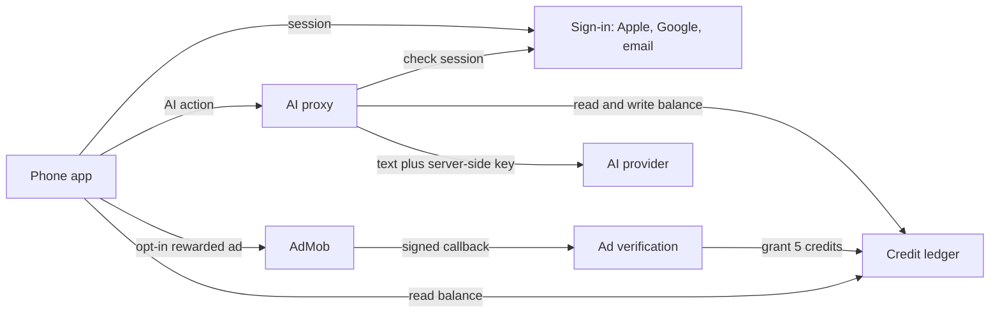

# LexiMD architecture

Status: planning. The phone app is React Native with Expo SDK 58 (stack decided 2026-10-25; SDK 58 so the current App Store Expo Go can open it). The boxes below are responsibilities. The hosting vendor and the AI provider are still chosen later; see [PLAN.md](PLAN.md).

## Components

| Piece | Role |
| --- | --- |
| Phone app | Holds the notes, the editor, and the preview. Bundles the markdown and mermaid libraries so preview works offline. Through v1.1 it talks to the server for sign-in, AI actions, the balance, and purchases. Sync is a later phase, described at the end. |
| Sign-in | Apple, Google, and email. The proxy accepts an AI call only with a valid session. |
| AI proxy | The only component that calls the AI provider. The provider key lives in the server environment. |
| Credit ledger | Per-user balance and transactions. Adds credits from a verified ad callback and, in v1.1, a verified store purchase. Subtracts credits when an AI result is returned. |
| Ad verification | Checks the AdMob server-side verification signature and a one-time transaction id, then grants 5 credits. |
| AI provider | One provider and one cheap model in v1. |

The preview runs inside a WebView because the mermaid and markdown libraries are JavaScript. The WebView loads bundled files, not a CDN. WYSIWYG may use a WebView too, if the spike in [PLAN.md](PLAN.md) chooses that. The library, folders, credits, and settings stay native either way.

## What is stored where

On the device: note files, folders, tags, and the draft the user is typing. This remains the working copy after sync exists.

On the server in v1:

- Account identity.
- Balance and transactions (delta, reason, action name, request id or ad transaction id, time, token counts, estimated cost).
- The text of an AI request that is still inside its retry window. Deleted within 24 hours. A retry with the same request id returns that result and does not debit again.

Analytics events are limited to names such as app open, note created, AI action name, ad opt-in, reward granted, and sign-in. Crash reports carry stack traces. Neither carries note text.

## Data flow: AI action

1. The user opens a note. Nothing is uploaded.
2. The user taps Format, Diagram, or Auto-tag (later actions use the same flow). The credits sheet shows the cost before the request goes out.
3. The app sends the action name, the text that action needs, a request id, and the session.
4. The proxy checks the session, the balance, the per-user daily cap, and the global spend ceiling. Any failed check returns an error and leaves the balance as it is.
5. The proxy calls the AI provider with the key from the server environment.
6. On success, the proxy debits the action cost, stores the result under the request id, and returns the text. The app writes it into the local note.
7. On provider failure, the proxy returns an error and does not debit.
8. The proxy drops the request text within 24 hours. The AI proxy does not file that text into a note library.

## Data flow: rewarded ad to credits

1. The user is signed in and chooses to watch an ad. The ad is opt-in.
2. The app asks AdMob for a rewarded video. When the video ends, the app does not change the balance.
3. AdMob calls the verification endpoint with a signed callback. Verify the current signature steps in AdMob's server-side verification docs when building this.
4. The server checks the signature. It checks that this transaction id has not already granted credits. It adds 5 credits to that user.
5. A missing signature, a bad signature, or a repeated transaction id grants nothing.
6. The app reads the balance from the ledger. Until the callback lands, the screen can show the last known balance.

The ad request does not include note text.

## Data flow: purchase (v1.1)

The same rule as ads. The store notifies the server, or the app submits a receipt for the server to check with Apple or Google. The ledger changes only after that check. Restore purchases re-reads entitled subscriptions and credit packs from the store and reconciles the ledger. Verify the current receipt APIs at implementation time.

## Sync (v1.3, later)

Not part of v1. The diagram above is the v1 system. Sync adds a note store on the same server, behind the same sign-in. The note store is separate from the AI proxy and from the credit ledger.

- The phone keeps the working copy. The editor stays offline-first. Sync pushes and pulls when the network is up, for a signed-in user who turns backup on.
- Signed-out editing stays local and does not upload notes.
- Note bodies are encrypted at rest. Host-level encryption versus encryption in the application, and who holds the key, is decided at the start of v1.3. Verify what the host provides. A second device on the same account has to be able to read the backup, so a key that lives only on one phone needs a recovery path. Verify that path before building it.
- Account deletion deletes the synced notes.
- If two devices change the same note while offline, the app keeps both copies and asks the user which to keep.
- Sync is not an AI call. Note text goes to the note store. It reaches the AI provider only when the user taps an AI action.
- The privacy policy, the in-app disclosure, the Apple privacy labels, and the Google Data safety form are updated before this release.

Collaboration is later still, and paid. A subscriber would share a note or a folder with another account through this note store. That design is not decided, and it is not in the diagram.

